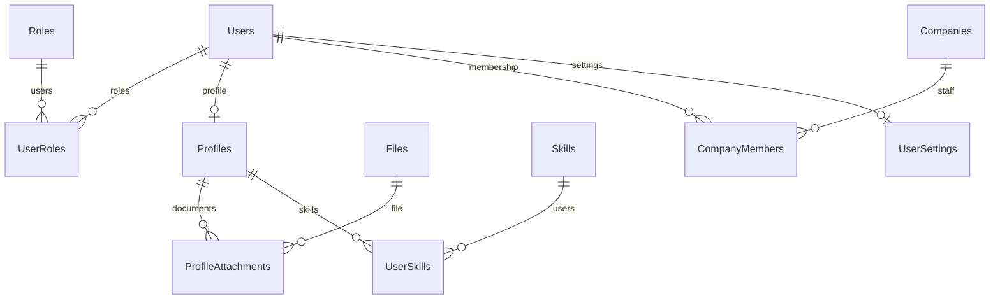
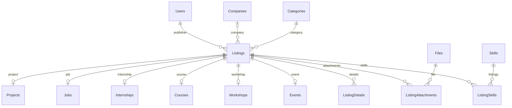
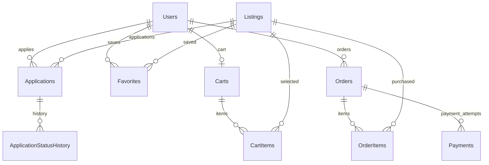
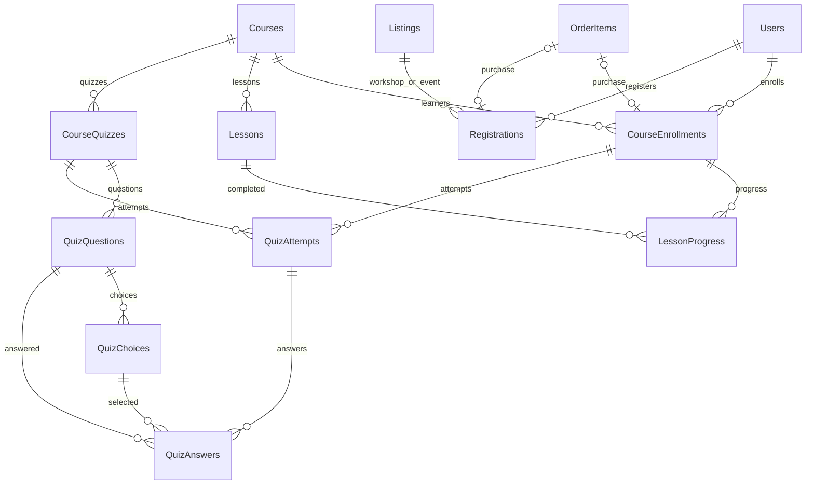
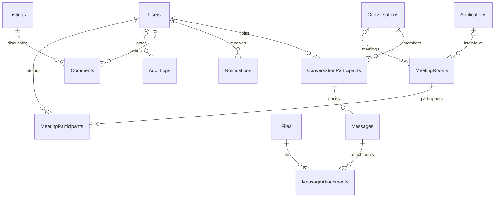

# مخطط علاقات Masterpiece

`||` = واحد، و`o|` = اختياري واحد، و`o{` = صفر أو أكثر. المخططات مبسطة؛ التعريف الدقيق للمفاتيح والقيود في ملفات SQL. كل سجل Listings له نوع تفاصيل واحد، والورش والفعاليات تستخدم Registrations.

## المستخدمون والشركات

## المحتوى المنشور

## التقديم والسلة والشراء

## التعلّم والفعاليات

## التواصل والمقابلات

